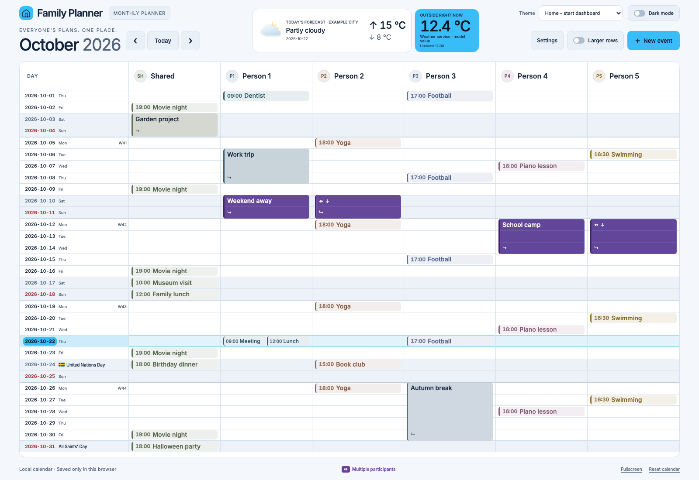

# Family Planner

A touch-friendly family calendar for wall displays, tablets and computers. See the whole month at once: one row per day and one column per person.

A fresh installation is empty, with **Shared** and **Person 1–5** columns. No accounts, locations or events are included.

*Example with fictional events and weather. A fresh installation starts empty.*

## Quick start

Requires Python 3.11 or newer.

    python3 -m venv .venv
    .venv/bin/python -m pip install -r requirements.txt
    .venv/bin/python serve.py --port 8086

Open http://127.0.0.1:8086/. Local-only mode also works by opening dist/index.html directly.
On Windows, use .venv\Scripts\python.exe instead of .venv/bin/python.

## Features

- Rename, color and reorder columns.
- Side-by-side activities, multi-day events with stable widths and multiple participants.
- Event notes and location, with previews in the day view and support in connected calendars.
- Tap a date or a dense day’s “+N” button for an enlarged, paged day view instead of scrolling inside cells.
- Add events with a separate “+” button even on occupied days. A selected start time defaults to a one-hour event; explicit end times are preserved.
- Connect iCloud, Google Calendar, Home Assistant, CalDAV and ICS feeds. Display multiple sources together.
- English by default, with optional Swedish. ISO dates (YYYY-MM-DD), 24-hour or AM/PM time.
- Swedish public holidays, observances and flag days, with localized names.
- Eight themes with light and dark modes, including e-ink and an Apple-inspired Liquid Glass theme.
- Today's forecast and outdoor temperature, with optional Home Assistant temperature sensors.
- Shared server-side columns, preferences, appearance and local events across devices, with automatic migration of existing browser settings.
- Persistent online event cache with background refresh and immediate invalidation after changes.
- Import and export local events and settings.

## Calendar connections and data

See [ONLINE-CALENDAR.md](ONLINE-CALENDAR.md) for provider setup, Google OAuth and editing capabilities.

Enter credentials in Settings. They are stored only in private server-side files outside the repository, normally under ~/.local/share/hemma-calendar/. Credentials are excluded from Git and JSON exports. Google requires your own OAuth client ID and client secret. No working credentials are included.

With the Python server, planner settings and local events are shared by devices using that server. Opening dist/index.html without the server keeps data in that browser. Online events are cached privately on the server for fast loading and refreshed from their providers. Resetting the planner does not delete online events.

## Home Assistant

See [home-assistant/README.md](home-assistant/README.md). The included HA OS app runs the online calendar service behind HA login and can be shown as its own dashboard. Local mode can also be served as static files. Installation is explicit; nothing is installed automatically.

## Tests

    .venv/bin/python -m pip install -r requirements-test.txt
    .venv/bin/python test_online_backend.py
    .venv/bin/python test_calendar_sources.py
    .venv/bin/python test_ha_websocket.py
    .venv/bin/python test_ha_ingress.py
    .venv/bin/python test_shared_state_cache.py
    .venv/bin/python qa-clean-template.py
    .venv/bin/python qa-multiple-calendars.py
    .venv/bin/python qa-settings-layout.py
    .venv/bin/python qa-event-entry.py
    .venv/bin/python qa-ha-adapter.py
    .venv/bin/python qa-shared-state.py
    .venv/bin/python qa-event-details.py

Browser checks use a separate temporary Brave profile and synthetic calendar data. Set BRAVE_BINARY when Brave is not installed in its default macOS location.

## Translations and fonts

English is the source and default language. The optional Swedish catalog is maintained in i18n.js. Run python3 sync_i18n.py after editing it to embed the catalog in dist/index.html. No external scripts are required.

The bundled Inter font is licensed under the SIL Open Font License; see [licenses/Inter-LICENSE.txt](licenses/Inter-LICENSE.txt).

## Event overview before editing

Selecting an existing event in the month or enlarged day view opens a read-only overview with its dates, start/end times, participants, location, notes and calendar. Choose **Edit** (**Ändra** in Swedish) to open the existing editor. Read-only, unavailable or non-updatable provider events have editing disabled. Adding a new event still opens the editor directly. Notes are the event description; this change does not add push notifications or reminder delivery.

The overview uses the selected theme and language, supports long notes on mobile and can be closed with Back, × or Escape. The read-first entry point is `openEvent`; `editEvent` opens the editor for integrations that already supply an overview (including the Surface Go wallboard). Source labels live in `i18n.js`; run `python3 sync_i18n.py` after changing them.

Verification: `python3 qa-event-overview.py` runs an isolated browser check without real calendar connections. Set `BRAVE_BINARY` to another Chromium-compatible executable if needed. `qa-event-details.py` exercises creating, viewing, editing and clearing notes/location against an isolated CalDAV server. HA deployment uses the existing [app build procedure](home-assistant/README.md). Back up the current build context and app data before rebuilding; the frontend update does not require changing calendar connections or shared preferences.
